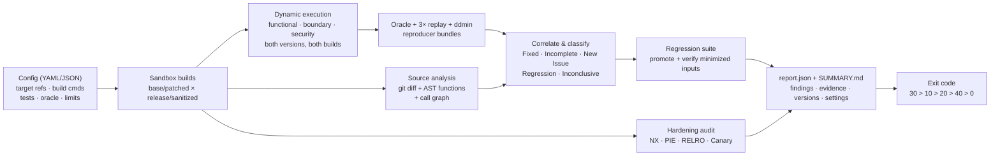

# patchguard
Automated security patch validation and regression testing for C/C++ applications in CI/CD pipelines.

## Pipeline



Every stage is driven by executed evidence, never by static text inspection or the
patched program's own output: crashes are replayed (3×) and minimized under a
strict crash-signature rule, findings are correlated to the git diff with
explicit Inconclusive when evidence is insufficient, and the independent
functional oracle is recorded with its provenance.

## Quick start

```bash
python3 -m venv .venv
.venv/bin/pip install -r requirements.txt   # pyelftools, pytest, pyyaml
docker build -t patchguard-sandbox:latest . # network needed once
./targets/build_fixture_target.sh           # deterministic C fixture target
./targets/build_cjson_target.sh             # real open-source target (network)
.venv/bin/python -m pytest -q               # full suite, incl. real Docker tests
```

## Modules

- `src/models.py` — shared dataclasses, crash-signature rules, exit codes
- `src/config/loader.py` — YAML/JSON target + validation config (strict pre-build checks)
- `src/builder/builder.py` — dual builds inside the sandbox image
- `src/runner/sandbox.py`, `src/runner/adapter.py` — isolated execution, stdin/file/argv input modes, resource limits
- `src/diagnostics/parser.py` — ASan/UBSan/gdb crash parsing into structured results
- `src/diff_parser/diff_analyzer.py` — git hunks, Clang function spans, caller/callee graph
- `src/correlator/correlator.py` — stack/coverage evidence linking findings to changed code
- `src/oracle/functional_oracle.py` — independent reference expectations
- `src/classifier/verdict.py` — five-state per-finding classification
- `src/hardening/elf_checker.py` — NX / PIE / RELRO / Canary + downgrade detection
- `src/reproducer/bundler.py` — 3× replay verification, self-contained `reproducers/<finding_id>/` bundles with `reproduce.sh`
- `src/minimizer/ddmin.py` — Delta Debugging minimizer with crash-signature equivalence
- `src/regression_gen/generator.py` — content-addressed regression inputs, atomic `manifest.json`, re-verification helpers
- `src/validation.py` — end-to-end `validate` orchestration
- `src/reporter/report_gen.py`, `src/orchestrator.py`, `src/cli.py` — reports, exit-code gate, CLI

Crash equivalence rule (shared by replay verification and minimization,
`strict_crash_match` in `src/models.py`): a match requires `crashed=True`, no
timeout/OOM kill, an error type, and the same top frame — line info is compared
only when both sides have it. Insufficient diagnostics, nondeterministic
replays, or a failed minimization revalidation skip minimization (original
input kept as fallback) and mark the finding inconclusive (exit code 40
downstream). In generated `reproduce.sh`, target env vars are applied only to
the child process via `env`, so they can never overwrite script internals.

## Cross-module contracts

- **Replay provenance:** `ReplayReport` carries `test_id`/`version`/`build_type`. Replay evidence from another test, version, or build can never confirm a finding; missing provenance is treated conservatively, never inferred.
- **Execution-context enforcement everywhere:** the shared `assert_execution_context()` rule is applied by replay verification, every minimization run (including final revalidation and lax mode), and regression verification. Any version/build/test change from a crash signature's original context is refused; violations raise, never `ok=True`.
- **CLI and reporter output guards:** `validate` rejects `--output-json`/`--output-md` that alias the input config (exit 30, nothing written); `report` keeps its `--results` protection; `write_reports()` rejects JSON/Markdown outputs that alias each other, including hard links and symlinks, before writing either file. All guards share the `paths_alias()` helper in `src/paths.py`.
- **Strict expectation validation:** regression expectations reject non-boolean `crash`, boolean/string `exit_code` values, missing required fields, unsupported manifest formats, and malformed entries — nothing is coerced, and rejections happen before any runner call or suite write. This applies to promotion, manifest deserialization, and the public `verify_regression()` API itself.
- **Full RELRO recognition:** immediate binding is detected via `DT_BIND_NOW`, `DF_1_NOW` in `DT_FLAGS_1`, and `DF_BIND_NOW` in `DT_FLAGS` (pyelftools and readelf paths).
- **ddmin empty input:** after the chunk loop the empty input is tested once, so a one-byte input can still reduce to empty (skipped when the iteration budget is exhausted).

## Running validations

```bash
PYTHONPATH=src .venv/bin/python -m patch_validator validate \
  --config targets/configs/scenario-correct.yaml \
  --output-json /tmp/pg-out/report.json --output-md /tmp/pg-out/SUMMARY.md
./run_all_scenarios.sh          # full 8-scenario matrix, asserts exact exit codes
./package_deliverables.sh       # collect reports, bundles, and suites into delivery/
```

`--base`/`--patched` optionally override the config's refs. The full
configuration schema is documented in [docs/09](<docs/09 - Validation Pipeline.md>).

The scenario matrix is verified with real Docker execution: correct→0,
incomplete→10, regression→20, no-bug→40, build-fail→30, and the cJSON
open-source target (CVE-2023-53154, pinned commits) correct→0,
incomplete→10, regression→20. Reports retain target refs, per-build commit
hashes, execution settings, oracle provenance, findings with correlation
evidence, per-run execution records, hardening results, reproducer records,
and the independent security/functional/analysis-completion statuses.

Reports can also be generated from classified upstream JSON:

```bash
PYTHONPATH=src .venv/bin/python -m patch_validator report \
  --results examples/classified_results.json \
  --output-json /tmp/patchguard-report/report.json \
  --output-md /tmp/patchguard-report/SUMMARY.md
```

The GitHub Actions workflow runs module tests, real container/cross-module
integration tests, and the full scenario matrix — Docker prerequisites fail the
required jobs rather than skipping their essential checks.

## Documentation

| Document | Description |
| --- | --- |
| [Project 1 Specification](<docs/پروژه ۱ - صورت پروژه (Project 1 Specification).pdf>) | Official project statement (Persian) |
| [Easy-Language Explanation of Project 1](<docs/01 - Easy-Language Explanation of Project 1.docx>) | Plain-language walkthrough of the project goals |
| [Task Breakdown, Structure & Deliverables](<docs/02 - 4-Person Task Breakdown, Structure & Deliverables.docx>) | Module split, structure, and deliverables |
| [Overall Architecture, Timeline & Task Dependencies](<docs/03 - Overall Architecture, Timeline & Task Dependencies.docx>) | Architecture overview, schedule, and task dependencies |
| [Development Plan — Reproducibility & Hardening](<docs/04 - Person 3 Development Plan.md>) | Build plan for the reproducibility, minimization, and hardening modules |
| [Reporting and Integration](<docs/05 - Person 4 Reporting and Integration.md>) | Reporting contract and integration work |
| [Analysis and Verdict](<docs/06 - Person 2 Analysis and Verdict.md>) | Diff analysis, oracle schema, and limitations |
| [Build and Execution Integration](<docs/08 - Person 1 Integration.md>) | Reconciled contracts, input semantics, and runner usage |
| [Validation Pipeline](<docs/09 - Validation Pipeline.md>) | End-to-end validate pipeline: setup, schema, targets, scenario matrix, limitations |
| [Final Report](<docs/10 - Final Report.md>) | Consolidated submission report: architecture, verification evidence, defense mapping |
| [Team Contributions](<docs/11 - Team Contributions.md>) | Verifiable module ownership vs. personal contribution claims |
